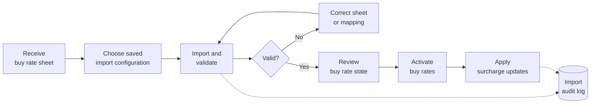
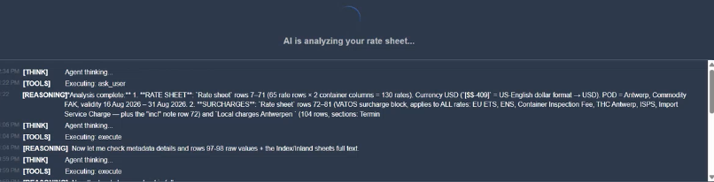

# Training for OptiRateX

Co-created with by 

## To do

- Check against Business Requirements to ensure that
  - Bugs are being resolved
  - All Requirements in scope are included
  - No extra Requirements
- Flows
- Screens > Claude-scan the application 
- Desired outcomes

## Introduction

Phase 1 BIG 

Context diagram

## Buy Rate Configuration

**Roles:** `Cost Rate Administrator`

### Service Definition

### Selected Drivers

### Vocabulary for ManuPort Logistic

## Buy Rate Ingestion & Updating

**Roles:** `Procurement` `Cost Rate Administrator`

### Smart AI Import

#### Requirements

| Issuecode | Samenvatting                                                 |
| --------- | ------------------------------------------------------------ |
| ORX-89    | How to ingest a Driver with Knowledge  (ex: Barge types)?    |
| ORX-3     | [Analysis] XML ingestion (TenderEasy  automated import) - Tender process |
| ORX-1     | Sales role should be able to ingest  tariffs that will be auto approved |
| ORX-2     | Excel ingestion (multiple supplier  templates)               |

#### Steps

#### Forms

#### Desired Outcomes

### Buy Rate Sheets

### Buy Rate State

### Import Audit Log

### Saved Import Configurations

### Surcharge Updates

## Buy Rate Search & Comparison

**Roles:** `Sales` `Operations`

### Buy Rate Lookup

### Compare Buy Rates

### Compare Spot Rates

### Buy Rate History