# Training Guide for OptiRateX

Co-created with by  **Draft of 16th November 2026** 

## Headlines

* [Buy Rate Configuration](#Buy Rate Configuration)
* [Buy Rate Ingestion & Updating](#Buy Rate Ingestion & Updating)
* [Buy Rate Search & Comparison](#Buy Rate Search & Comparison)

## Introduction

### Purpose of this training

OptiRateX is the central rate management platform of Manuport Logistics (MPL). It replaces buy rates scattered over Excel files, mailboxes and BC/LQS with one database that Procurement maintains and that Sales and Operations consult.

After this training you are able to:

- import a supplier rate sheet (Excel, PDF or email) with Smart AI Import and review the result;
- approve and publish buy rates, and see which rates are about to expire;
- apply a surcharge change to many rates at once;
- look up the valid buy rate for a shipment and collect rates in a basket;
- trace where a rate came from and who changed it.

### Phase 1 BIG 

Phase 1 is the pilot for Beaulieu International Group (BIG). It covers the Tender, Spot (offline) and FAK rates that MPL manages for BIG, for all transport modes, including surcharges, demurrage and detention.

### Context

Below the Persons and the OptiRateX they will respectively be using:

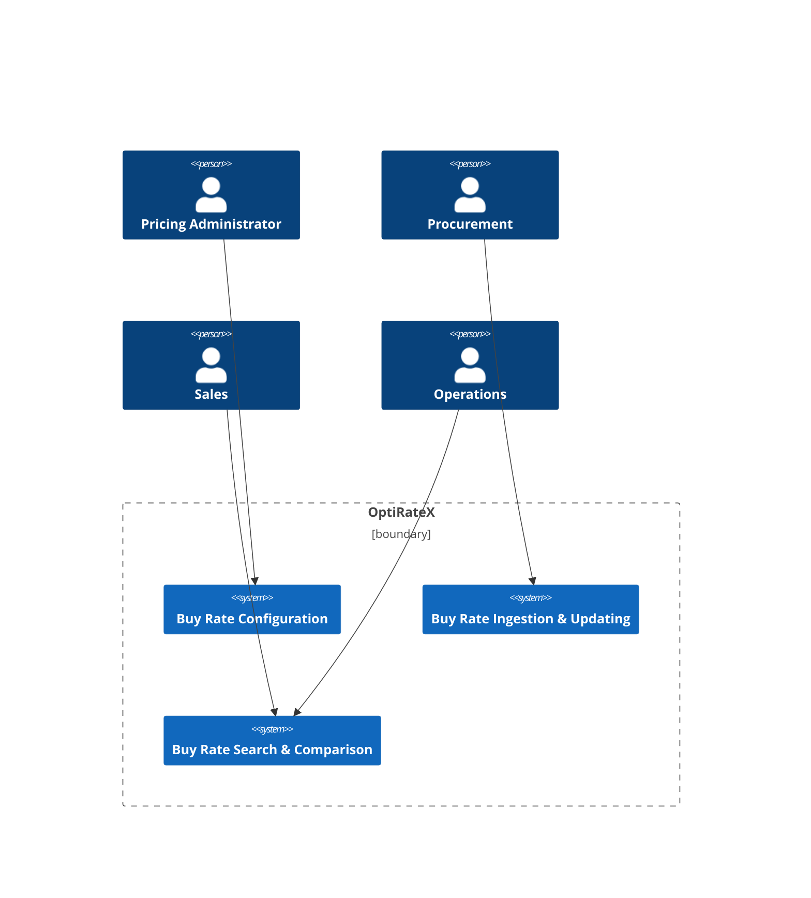

### Roles

| Role in this manual | What you do in OptiRateX | Main menu items |
| ------------------- | ------------------------ | --------------- |
| `Pricing Administrator` | Define services, drivers, vocabulary and surcharge rules | Configuration |
| `Procurement` | Import, review, publish and update buy rates | Rate Sheets, Rate state, Surcharge Updates, Import Configs, Import Audits |
| `Sales` | Look up and compare buy rates, build a basket | Rate Lookup, Shopping Basket, Shared links |
| `Operations` | Look up the valid buy rate for a shipment | Rate Lookup |

### Navigation

Sign in with your Manuport account (Azure Entra ID single sign-on, ORX-66). The left sidebar has three groups:

| Group | Menu items |
| ----- | ---------- |
| (main) | Home, Rate Sheets, Rate state, Surcharge Updates, Suppliers, Tenders, Named Accounts, Import Configs, Import Audits, Rate Audit, Import Verification, Background Jobs |
| Configuration | Drivers, Surcharge Rules, Services, Service Types, Solution Segments, Categories, AI Preferences, Vocabularies, Charge Codes, Charge-Code Backfill, API Tokens |
| Sales | Rate Lookup, Shopping Basket, Shared links |

The top bar has a button to collapse the sidebar and a light/dark mode switch. All list screens can be sorted by clicking a column header (↕).

**Home** shows the dashboard: Approved Rates, Pending Approval, Active Suppliers, Total Suppliers, Tenders, Named Accounts and Total Imports. Each tile is a shortcut to the matching list.

### Key terms

| Term | Meaning |
| ---- | ------- |
| Buy rate | Price a supplier charges MPL for a logistics service. In the application a buy rate is called a *rate*; a *rate sheet* is the supplier document it came from. |
| Service | The kind of service a rate is for, e.g. SEA FCL or Pre-Carriage FCL Road. |
| Driver | A property that determines the price, e.g. Port of Loading (POL), Container Type (CONTAINER). |
| Surcharge | Fee on top of the base rate, e.g. BAF, ETS, fuel surcharge. A *conditional* surcharge only applies in certain cases. |
| Tender | A set of pre-negotiated rates, e.g. BIG. |
| Named Account (NAC) | A customer-specific rate set. |
| FAK | Freight All Kinds: a flat rate regardless of cargo type. |
| Spot rate | Current market rate, not contracted. |
| Draft / Published | A draft rate awaits review. A published rate is approved and visible in Rate Lookup. |

## Buy Rate Configuration

**Roles:** `Pricing Administrator`

Configuration is done once per service and changes rarely. It decides which columns the AI looks for during import and which filters Sales sees in Rate Lookup.

### Training objectives

After this chapter you are able to:

- explain what a service is and how it is built up from drivers and a price;
- find the service that fits a buy rate, such as customs, container handling or fumigation;
- tell when a terminal handling charge (THC) is a service of its own and when it is a surcharge;
- set up a road transport service, including poule transport;
- use the agreed Manuport terms for drivers, services and surcharges;
- look up a charge code in the master list and see which supplier names map to it;
- create a new driver and add it to a service.

### Service Definition

**Menu:** Configuration > Services

A service definition describes one kind of buy rate. The overview shows a card per service with its number of drivers, whether spot rates are enabled and how many rates exist. 

A Service in OptiRateX is decomposed as followed:

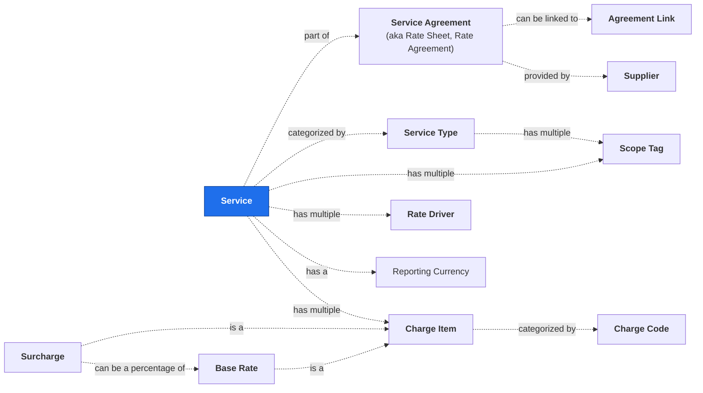

The following Services are covered in Phase 1:

- Services in DEV 
- Container Actions
- Customs Service 
- Ocean Freight FCL Standard
- On-Carriage FCL Road
- Pre-Carriage FCL Barge
- Pre-Carriage FCL Road
- SEA FCL
- Value Added Service

#### Steps

1. Open **Services** and click a card to edit it, or **+ Create Service**.
2. Fill in the general fields (see table).
3. Add and order the drivers (see *Selected Drivers*).
4. Click **Save Changes**.

#### Forms

| Field | Explanation |
| ----- | ----------- |
| Service Name | Name shown everywhere in the application. |
| Description | Free text shown on the service card. |
| Category | Customs, Interventions, Locals, Sea Freight or Transport (maintained under Configuration > Categories). |
| Unit of Measure (Default) | Fixed (Per Order), Per Container (CTN), Per Piece (PCS), Percentage (%) or Weight/Measurement (W/M). |
| Reporting Currency | EUR or USD. |
| Enable spot rates | Lets Rate Lookup users include spot offers for this service. |
| Spot lookup backend | Source of the spot offers (e.g. Sea spot rates). |
| Grace period (days) | 0 = off. When no rate is valid on the quote date, Rate Lookup still shows rates that expired at most this many days earlier, marked "Grace period". |
| Dangerous goods (IMO) | Rates of this service record the IMO classes they accept. A rate without classes is a non-IMO rate. |

#### Desired Outcomes

- Every service MPL buys for BIG exists once, with an agreed name.
- A new service can be imported and searched without help from CNEXT.

**[To confirm]** Dangerous goods (IMO) was discussed in the 16 Nov demo, while ORX-32 places IMO as a dimension in Phase 2. Spot rates and the grace period are visible in DEV; ORX-71/ORX-72 ask to hide features that are not in Phase 1 scope in UAT.

### Selected Drivers

**Menu:** Configuration > Services > (service) > Selected Drivers (Inputs); driver master list under Configuration > Drivers

Drivers are the properties that make up a rate. SEA FCL uses 18 drivers, in this order: Lane, Place Of Receipt (POR), Place Of Delivery (PLD), Port of Loading (POL), Port of destination (POD), Shipping terms, Incoterm, Supplier, Origin ICD, Commercial Type, Container Type, Transit Time, Direct, Frequency, Free Time, Remarks, Contractref / Filingnr, Allocation.

#### Steps

1. In the service, find the driver under **Available Drivers** and click **+** to add it. Use **+ Create New Driver** if it does not exist yet.
2. Drag the handle (⋮⋮) or use ↑ ↓ to set the order.
3. Set the options per driver (see table).
4. Click **Save Changes**.

#### Forms

| Option | Explanation |
| ------ | ----------- |
| Info only | The driver is shown on the rate but does not act as a search key. **[To confirm]** |
| LOCODE reference | The value must be a UN/LOCODE location (e.g. BEANR). |
| LOCODE function | Limits the locations to one type: PORT, RAIL, ROAD, AIRPORT, POSTAL, MULTIMODAL, BORDER, FIXED_TRANSPORT, or Any. |

A driver has a Code, Name, Type (String, Number or Boolean) and Description. Maintain the master list under **Configuration > Drivers** (**+ Add Driver**, Edit, Delete).

#### Desired Outcomes

- The drivers of a service match the columns of the supplier rate sheets, so the AI import maps them without questions.
- Location drivers use LOCODE, so "Antwerp", "ANTWERPEN" and "BEANR" end up as the same value.

### Vocabulary for ManuPort Logistic

**Menu:** Configuration > Vocabularies

The vocabulary holds the standard value for a driver and the synonyms suppliers use for it. After an import the normaliser replaces every synonym with the standard value (e.g. MELBOURNE becomes AUMEL, 40' High Cube becomes 40HC).

Entries are grouped per service and driver. In DEV: SEA FCL / CONTAINER (7), SEA FCL / POD (460), SEA FCL / POL (162), Customs Service / FORM (5), Pre-Carriage FCL Road / PLD (7), On-Carriage FCL Road / POR (3).

#### Steps

1. Filter on **Service** and **Driver Code**.
2. Open a group to see its standard values and synonyms.
3. Click **+ Add Vocabulary Entry** to add a standard value or a synonym.

#### Forms

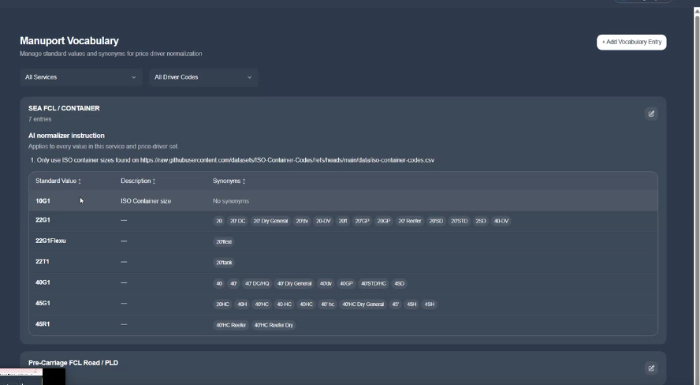

#### Desired Outcomes

- One spelling per port, container type and customs formality across all suppliers (ORX-87, ORX-99).
- Rate Lookup filters show each value once.

### Other configuration screens

| Menu item | Purpose | Audience |
| --------- | ------- | -------- |
| Surcharge Rules | How a conditional surcharge behaves in the basket (e.g. ETS, "Off by default"). | Pricing Administrator |
| Charge Codes | Master list of standard charge codes (e.g. ADM-DOC-BL Bill of Lading Fee) with their aliases; used to map supplier surcharge names during import and to line up surcharges in comparisons. | Pricing Administrator |
| Categories | Groups of services (Customs, Interventions, Locals, Sea Freight, Transport). | Pricing Administrator |
| Service Types, Solution Segments | Blueprints and transport legs (Origin inland, Main leg, On-carriage, Customs, Destination) behind the service definitions. | CNEXT / key user **[To confirm]** |
| AI Preferences | Extra instructions for the AI per process (e.g. LocationMapping). | CNEXT / key user **[To confirm]** |
| Charge-Code Backfill, API Tokens, Import Verification, Background Jobs | Technical administration. | CNEXT only; not part of end user training |

## Buy Rate Ingestion & Updating

**Roles:** `Procurement` `Pricing Administrator`  

### Smart AI Import

**Menu:** Rate Sheets > Import Excel, or Import Configs > + New import

Smart AI Import reads a supplier rate sheet, extracts the rates and surcharges, and stores them as draft rates. The button is called "Import Excel" but accepts Excel, CSV, PDF and email files (ORX-83).

#### Training objectives

After this chapter you are able to:

- import a supplier rate sheet from Excel, also when suppliers use different templates;
- import rates from a PDF rate sheet;
- import rates and surcharges from a supplier email by dragging the file into OptiRateX;
- help the AI understand a value that needs background knowledge, such as barge types;
- answer the questions the AI asks during an import and correct its result with extraction rules;
- save your import configuration, so the next sheet from the same supplier needs no new prompting;
- split a large rate sheet or adjust the import when a file is slow or does not load;
- explain what the automated validation checks and what you review yourself before rates are approved;
- explain when rates imported by Sales are approved automatically;
- describe how tender rates from TenderEasy reach OptiRateX;
- carry out the initial upload of the BIG rate sheets.

#### Steps

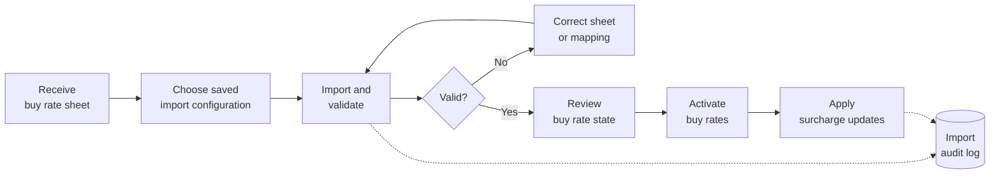

1. **Setup.** Choose a **Supplier**, a **Tender** or **Named Account**, or both. A tender or named account alone is allowed when the sheet has no single supplier. Choose the **Service Definition**.
2. **Saved profile.** If saved profiles exist for this supplier and service, the screen shows them. Leave **Use saved config** on and keep **Profile** on "Auto" to try each saved profile, most recently used first. Turn on **Use AI to adjust the saved logic** only when the sheet layout has changed.
3. **Options.** Optionally add **Structure hints** (e.g. "rates are on the second sheet"). Decide on **Start normalisation automatically after import** and **Enable human-in-the-loop**.
4. **Upload.** Drag the files onto **Upload rate sheets** or click **Select rate sheet files**. Limits: 10 files, 10 MB each, 50 MB in total. Each file is imported on its own.
5. **Analysis.** The AI analyses the sheet and shows its reasoning. With human-in-the-loop on, it pauses and asks a question when something is ambiguous. Answer in the chat panel.
6. **Review.** Check the extracted rates and surcharges. Correct the extraction by adding an **Extraction rule** in plain language and clicking **Rerun with rules**. The AI may suggest rules; click to add them.
7. **Confirm.** Choose what happens under **Import options** (see table) and confirm.
8. The rates are stored as **Draft**. If automatic normalisation is on, a 5-second countdown starts the vocabulary normaliser and then the surcharge standardisation for this batch.

#### Forms

| Field (Setup) | Explanation |
| ------------- | ----------- |
| Supplier | Supplier of the rates. Optional when a Tender or Named Account is selected. |
| Tender / Named Account | Links the rates to a tender (e.g. BIG) or a customer-specific rate set. |
| Service Definition | Decides which drivers the AI looks for. |
| Use saved config / Profile | Reuses a saved import configuration without AI (fastest). |
| Use AI to adjust the saved logic | Lets the AI adapt the saved parser to a changed layout. |
| Structure hints | Free text about the file layout; only used when the AI analyses from scratch. |
| Start normalisation automatically | Runs vocabulary and surcharge standardisation right after the import. |
| Enable human-in-the-loop | The AI asks clarifying questions instead of guessing. |
| Debug mode | Shows technical detail; not needed for daily use. |

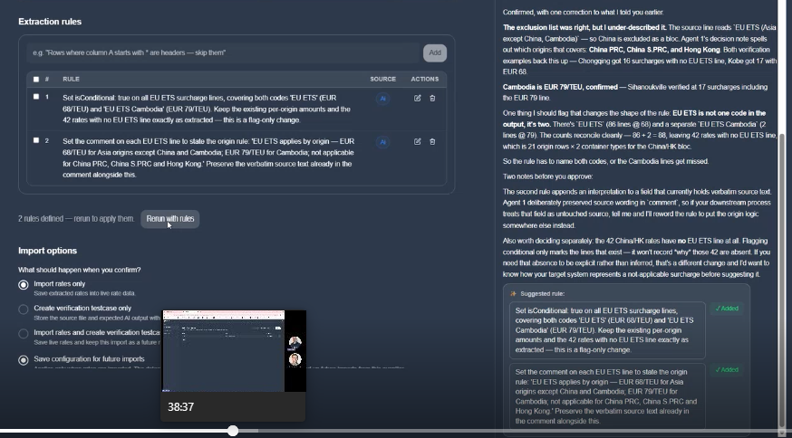

| Import option (Review) | Explanation |
| ---------------------- | ----------- |
| Import rates only | Saves the extracted rates as draft rates. |
| Create verification testcase only | Stores the file and expected output as a test, without importing. For CNEXT. |
| Import rates and create verification testcase | Both of the above. |
| Save configuration for future imports | Stores the extraction rules as a saved import configuration, so next month's sheet from this supplier imports without prompting. |

#### Desired Outcomes

- A monthly FAK sheet from a known supplier is imported with its saved configuration, without new prompting.
- Rate update cycle time under 30 minutes from ingestion to live; a full Excel dataset imports in under 10 minutes.
- Data entry error rate below 1%.
- Every import leaves a record in the Import Audit Log.

**[To confirm]** XML ingestion from TenderEasy is a Phase 1 item in the Delivery Plan, while Jira moved the build to Phase 2 (ORX-104) and keeps only the analysis in Phase 1 (ORX-3). The manual does not describe XML import until this is settled. Auto-approval of rates ingested by Sales (ORX-1) is not visible in DEV.

### Buy Rate Sheets

**Menu:** Rate Sheets

The list of all rates, imported and manual, with their approval status. This is where Procurement reviews draft rates and publishes them.

#### Training objectives

After this chapter you are able to:

- tell tender, spot and FAK rates apart in the rate list;
- find the rates you need to review with the search bar and the filters;
- validate updated rates after an import or a surcharge update;
- approve and publish rates, and explain what the automated validation has already checked;
- read a price in its own currency and explain how it is converted with exchange rates;
- link a rate to a named account;
- explain how the central database is organised, so you see the rates that matter to you and not all rates in one view.

#### Steps

1. Filter the list with the search box (port, surcharge, batch) and the **All Batches**, **All Statuses** and **All Origins** filters. Filter on the import batch you just loaded.
2. Check the rates: price and unit, validity, surcharges (fixed and conditional) and attributes. Click **Edit** to correct a single rate.
3. Approve and publish the rates. **[To confirm]** The exact approve/publish action (per rate, per selection or per batch) was not captured in the scan.
4. Use **Normalize Data** to run the vocabulary normaliser if it did not run after the import.
5. Use **+ Add New Rate** for a rate that has no source file: choose Supplier, Service Definition, Tender and Named Account, then **Create Draft Rate** and fill in the drivers and price.

#### Forms

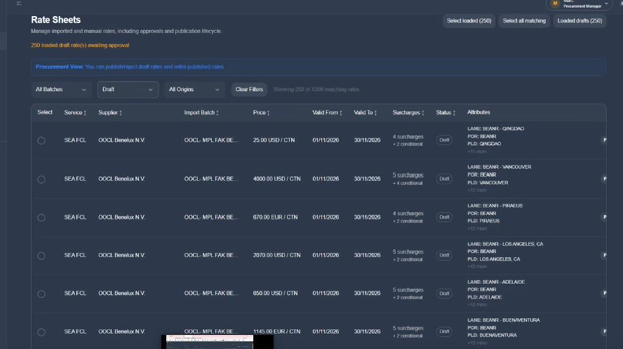

| Column | Explanation |
| ------ | ----------- |
| Service | Service definition of the rate. |
| Supplier | Supplier, or tender when there is no single supplier. |
| Import Batch | Source file the rate came from. |
| Price | Base rate with currency and unit, e.g. 405.00 USD / CTN. |
| Valid From / Valid To | Validity period. "Until Cancelled" means no end date. |
| Surcharges | Number of surcharges, with conditional ones counted separately. |
| Status | Draft or Published. **[To confirm]** full list of statuses. |
| Attributes | The driver values, e.g. LANE, POR, PLD. |
| Actions | Edit, Delete. |

#### Desired Outcomes

- Sales and Operations only see rates that Procurement has reviewed and published.
- No buy rates are kept in private Excel files any more: one source of truth.

### Buy Rate State

**Menu:** Rate state

Shows the published rates and surcharges that stop being covered soon and have no published replacement yet.

#### Training objectives

After this chapter you are able to:

- see which published rates expire soon and have no replacement yet;
- open the Rate state screen from your own role, whether you work in Procurement, Sales or Operations;
- check the validity period of a surcharge separately from the validity of its rate;
- act on an upcoming expiry by requesting and importing new rates in time.

#### Steps

1. Set **Expiring within (days)**. The screen shows the period it covers, e.g. "Today up to and including 30 Nov 2026".
2. Read the totals: **Rates expiring** and **Surcharges expiring**.
3. Expand the tree: Tender or NAC > Service > Supplier. Each line shows the counts and the first expiry date.
4. Click a count to open those rates in Rate Lookup.
5. Ask the supplier for new rates and import them before the first expiry date.

#### Forms

#### Desired Outcomes

- No shipment is booked against an expired rate (KPI: shipment accuracy of at least 80%).
- Procurement sees a month ahead which suppliers must send new rates.

### Import Audit Log

**Menu:** Import Audits

Read-only list of every import: Date, File, Supplier / Tender / NAC, Service, Results (e.g. "+266 created", "Warnings") and Imported By.

#### Training objectives

After this chapter you are able to:

- look up who imported or changed a rate, and when;
- follow the versions of a rate from import to publication;
- trace a rate back to the file, email or import run it came from;
- open the original source document from the history of a rate.

#### Steps

1. Find the import by date, file or supplier.
2. Click **View Details** to see what was created and which warnings were raised.
3. Follow up on warnings before publishing the batch.

#### Forms

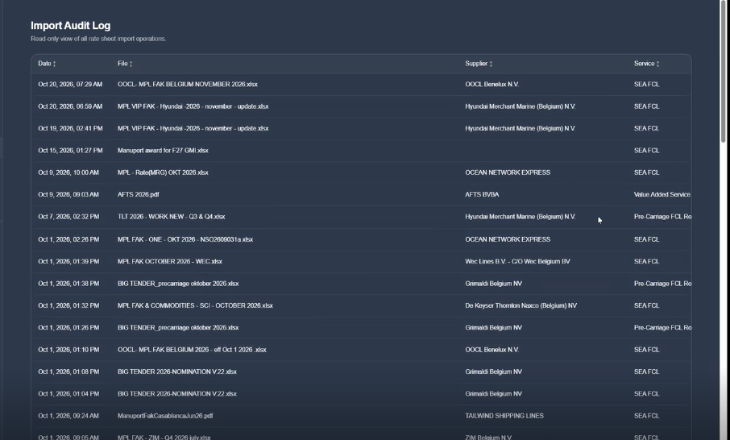

The separate **Rate Audit** screen lists every manual and system change to a single rate (Action, Rate, Origin, Actor, When), with filters on Rate ID, Actor and date.

#### Desired Outcomes

- For any rate, you can show which file it came from, who imported it and when.

### Saved Import Configurations

**Menu:** Import Configs

A saved import configuration is a reusable extraction profile for one supplier (or tender), service and file type. A supplier can have several active profiles per service and file type.

#### Steps

1. Find the profile by Name, Supplier / Tender / NAC, Service or Source (Excel, PDF, Email).
2. Click **Use as template** to start a new import with this profile.
3. Click **Edit** to change the profile, or **Delete** to remove it. A changed profile gets a new version; the old version becomes Inactive.

#### Forms

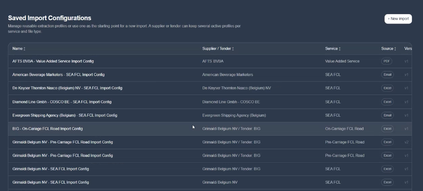

| Column | Explanation |
| ------ | ----------- |
| Version / Status | v1, v2 ...; Active or Inactive. |
| Imports / Last Used | How often and when the profile was last used. |

#### Desired Outcomes

- The prompting effort for a supplier template is spent once (ORX-74).

### Surcharge Updates

**Menu:** Surcharge Updates

Applies one surcharge change (e.g. a new BAF or fuel percentage) to all matching draft and published rates of a tender or supplier, with a preview and a report.

#### Training objectives

After this chapter you are able to:

- apply a surcharge change to all matching rates of a supplier or tender in one update;
- let the AI fill in a surcharge update from a supplier email, PDF or Excel file;
- check the preview before you apply an update, and undo an update afterwards;
- limit a surcharge update to the carrier region it applies to;
- recognise a surcharge by its standard name, whatever the supplier calls it.

#### Steps

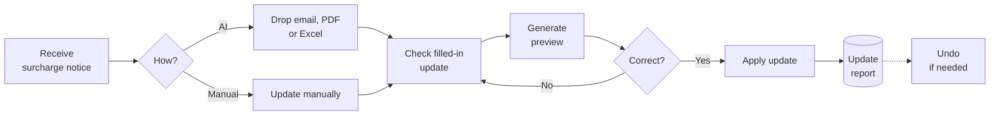

1. Start the update:
   - **Update with AI:** drop supplier emails (EML, MSG), PDFs or Excel files on the drop zone. Each file is read as its own notice. Limits: 10 files, 25 MB in total. The AI fills in the update for you.
   - **Update manually:** click **Update manually**.
2. **Select:** Tender (or "No tender (use supplier)"), Supplier, Service, Surcharge code and Amount type (Fixed or Percent).
3. **Update details:** Valid from, Valid until, Change mode and the value. Valid from defaults to the first day of next month, Valid until to the end of that year.
4. Generate the **Preview report** and check the affected rates and the impact.
5. Click **Apply update**.
6. Open the report with **View** under Recent update reports. An applied update can be undone from its report.

#### Forms

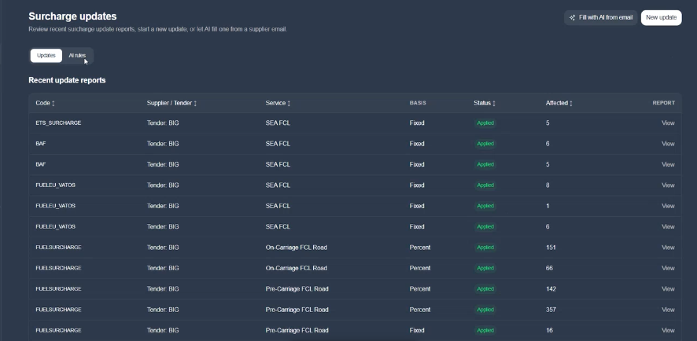

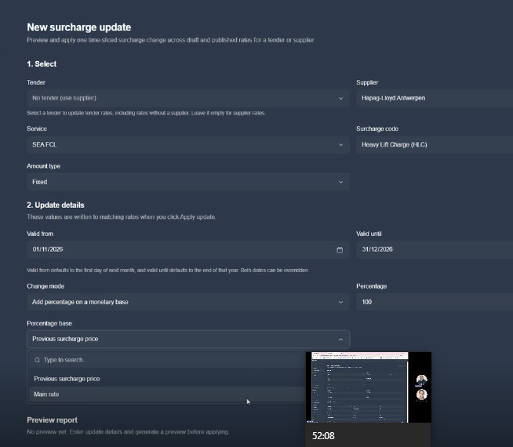

| Field | Explanation |
| ----- | ----------- |
| Change mode | E.g. "set absolute" or "Add percentage on a monetary base". **[To confirm]** full list. |
| Percentage base | For a percentage: "Previous surcharge price" or "Main rate". |
| AI rules (tab) | Rules the AI remembers per supplier for reading surcharge notices. |

The report shows Affected, Draft, Published, Previous impact, New impact and Impact delta, the operation and selection filters, and one line per affected rate with old and new basis.

#### Desired Outcomes

- A surcharge notice is processed once for all rates instead of rate by rate.
- Sales quotes with the surcharge that is valid on the quote date.
- Each update is documented and reversible.

### Suppliers, Tenders and Named Accounts

| Menu item | Purpose |
| --------- | ------- |
| Suppliers | Read-only list synchronised from the master data ("Sync from MC"): Name, Vendor No., MC Partner ID, Last Synced. Suppliers are not created in OptiRateX. |
| Tenders | Create a tender (**+ Add New Tender**: Name, Type Open or Limited, Description) and attach documents. BIG is a tender. |
| Named Accounts | Create a customer-specific rate set (**+ Add New Named Account**). |

**[To confirm]** What "MC" stands for and who triggers the sync.

## Buy Rate Search & Comparison

**Roles:** `Sales` `Operations`

### Training objectives

After this chapter you are able to:

- find the valid buy rate for a shipment by service, quote date, origin, destination and supplier;
- tell tender, spot and FAK rates apart in the search results;
- collect rates in a basket, with the conditional surcharges that apply, and export or share the basket;
- open the history of a rate to see where it came from and what changed.

### Buy Rate Lookup

**Menu:** Sales > Rate Lookup

The central database as Sales and Operations see it: all published buy rates that are valid on the quote date.

#### Steps

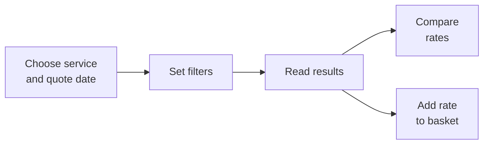

1. Choose the **Service**. The filters for that service's drivers appear.
2. Set the **Quote date** (default: today) and optionally a **Tender** and **Supplier**.
3. Set the driver filters, e.g. Port of Loading, Port of destination, Container Type. Each filter accepts several values.
4. Read the results. Each line shows the provider, the lane, base rate, surcharges and total, validity and the remaining driver values. Sort with **Sort by** (e.g. Total price, low to high).
5. Compare rates or add a rate to the basket (see *Shopping Basket*).

#### Forms

#### Desired Outcomes

- Single-view access to all applicable buy rates.
- Sales quotes on the rate and surcharges valid on the quote date; fewer buy-side invoice disputes.

### Shopping Basket

**Menu:** Sales > Shopping Basket; the active basket is also shown at the top of Rate Lookup

A basket collects the buy rates you picked for one enquiry, for example the pre-carriage, sea freight and customs rates of a shipment. Each rate is stored as a snapshot, so the basket keeps the price as it was when you added it.

#### Steps

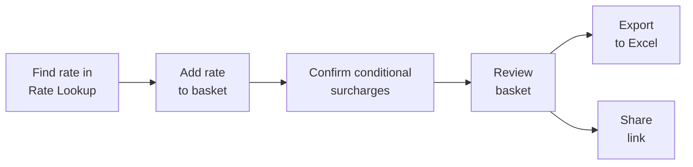

1. In Rate Lookup, check which basket is active (e.g. "Basket #39 · 0 rates"). Switch to another basket or start a new one if needed.
2. Add a rate to the basket from the search results.
3. In **Confirm basket additions**, tick the conditional surcharges that apply to this shipment and click **Add rate**. Which surcharges are ticked by default is set under Configuration > Surcharge Rules.
4. Repeat for the other services of the shipment.
5. Open **Shopping Basket** to review the rates. Remove a rate you do not need, or use **Clear basket** to empty it.
6. Give the basket a recognisable name with the rename button.
7. Click **Export to Excel** to use the rates in a quote, or **Share link** to send the basket to a colleague. A shared link stops working after 90 days; delete it under Sales > Shared links to withdraw it sooner.

#### Forms

| Element | Explanation |
| ------- | ----------- |
| Basket selector | Shows the active basket and its number of rates; switches between saved baskets. |
| New basket | Starts an empty basket. |
| Created / Pricing date | When the basket was made, and the quote date its rates were priced on. |
| Export to Excel | Downloads the rates of the basket. Not available for an empty basket. |
| Share link | Creates a link to the basket that is valid for 90 days. |
| Clear basket | Removes all rates from the basket. |

#### Desired Outcomes

- All buy rates for one enquiry are together in one place, with the surcharges that apply.
- The buy-side input for a quote is handed over as one Excel file or link, not retyped.

**[To confirm]** The basket and shared links are not listed in the contract requirements; decide whether they are trained in Phase 1. A screenshot of the Shopping Basket screen itself is still missing, and what a shared link shows to the receiver was not checked.

### Compare Buy Rates

Select two or more rates in the results to compare them side by side. The comparison lines up supplier, base rate, each surcharge (by standard charge code), total and validity. A dot marks a value that differs, the best price is underlined, and **Differences only** hides the equal lines.

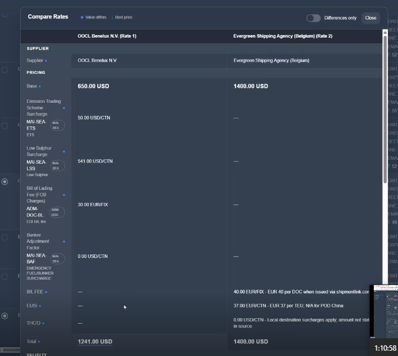

**[To confirm]** Rate comparison across carriers is a Phase 2 requirement (ORX-6). Keep or drop this section for the Phase 1 training.

### Compare Spot Rates

For a service with spot rates enabled, **Include spot** adds stored spot offers to the search and **Fetch spot rates** requests live offers. The **Spot comparison** shows each offer with base rate, surcharges, total, validity, departure and arrival, and its differences from the managed rate.

**[To confirm]** Phase 1 covers offline spot rates only. Live carrier offers are Phase 3 (ORX-5) and are to be hidden in UAT (ORX-72).

### Buy Rate History

Open the history of a rate to see how it was created, changed and where it came from: the source file (**Download source**), and one line per event (Created, Import run, Standardized, Published) with who and when. Click an event to see the changed fields, with before and after values.

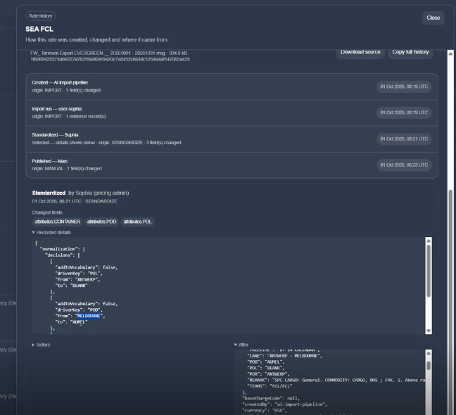

#### Desired Outcomes

- A disputed rate can be traced back to the supplier document in one click (ORX-11, ORX-85).

